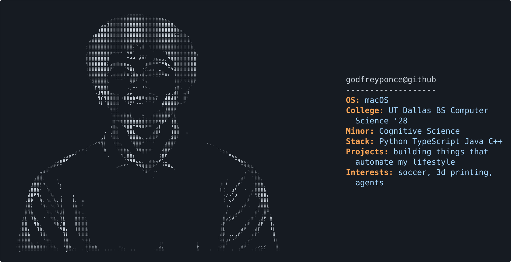
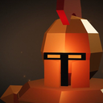
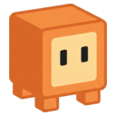

<picture>
  <source media="(prefers-color-scheme: dark)" srcset="dark_mode.svg">
  <source media="(prefers-color-scheme: light)" srcset="light_mode.svg">
  
</picture>

Junior CS student in Dallas. Most of these started as a problem I had that week so I built my solution. [virus](https://godfreyponce.dev) and [LinkedIn](https://www.linkedin.com/in/godfreyponce/)

## Things I actually use every day

 **[kal](https://github.com/godfreyponce/kal)** Started tracking my calories, so I built a tracker
 

 **[pauri](https://github.com/godfreyponce/pauri)** The ChatGPT classic Mac app is retiring, so I built my own quick-chat window that runs on Codex
 

 **[canvas-kit](https://github.com/godfreyponce/canvas-kit)** Puts every UTD Canvas due date in my Obsidian vault, plus a Monday rundown of what's due
 

## Work stuff

 **[jiraPlane](https://github.com/godfreyponce/jiraPlane)** A paper airplane flies across my screen when Jira needs me
 

 **[WP-Admin-Wordpress](https://github.com/phamleduy04/WP-Admin-Wordpress/pulls?q=is%3Apr+author%3Agodfreyponce+is%3Amerged)** Internal tool for my web dev team, a browser extension for UT Dallas WordPress sites. I fixed bugs and added features in 3 merged PRs
 

## Hackathons

 **[ITHACA](https://github.com/godfreyponce/hackuta-26)** HackUTA 2026. A webcam fighting game where a friend on FaceTime forges your weapons. I built the call agent
 

<picture><source media="(prefers-color-scheme: dark)" srcset="assets/icons/land-dark.png"><source media="(prefers-color-scheme: light)" srcset="assets/icons/land-light.png"></picture> **[LAND](https://github.com/godfreyponce/hackutd-26)** HackUTD 2026. A box that asks out loud if you're okay after an earthquake, and raises an alarm if you don't answer
 

 **[EchoMap](https://github.com/godfreyponce/hacksmu-26)** HackSMU project with a teammate. Cleans noise out of elephant recordings
 

 **[CometAdvisor](https://github.com/godfreyponce/hackai-26)** HackAI. Academic advisor for UTD students (but we have advisors?). Actively working on it
 

## Everything else

 **[clawd](https://github.com/godfreyponce/clawd)** I 3D printed [clawd-mochi](https://github.com/yousifamanuel/clawd-mochi), a crab for my desk, so I know how my agents are doing
 

 **[terrariaCompanion](https://github.com/godfreyponce/terrariaCompanion)** Played Terraria for the first time this year, idk where to start, so I built this
 
